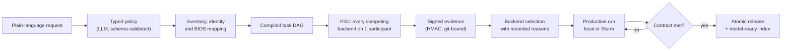

<p align="center">
  
</p>

<h1 align="center">NeuroPrep</h1>

<p align="center">
  <b>One request in, validated multimodal neuroimaging derivatives out.</b><br>
  An agentic study compiler that turns a plain-language request into a pilot-qualified,<br>
  fully provenanced preprocessing run, from raw MRI, PET, CT, EEG/MEG and more to a released, model-ready dataset.
</p>

<p align="center">
  
  
  
  
  <a href="https://biomedia-mbzuai.github.io/NeuroPrep/"></a>
  
</p>

<p align="center">
  <a href="#quick-start">Quick start</a> ·
  <a href="#how-it-works">How it works</a> ·
  <a href="#validated-backend-comparisons">Backends</a> ·
  <a href="#supported-modalities">Modalities</a> ·
  <a href="#chat-and-live-dashboard">Chat &amp; dashboard</a> ·
  <a href="https://biomedia-mbzuai.github.io/NeuroPrep/">Documentation</a> ·
  <a href="#license-and-citation">Citation</a>
</p>

---

## Why NeuroPrep

Preprocessing a multimodal, longitudinal neuroimaging study usually means stitching
together a dozen tools by hand, guessing which backend suits your data and hardware,
and hoping nothing silently fails three days into a cluster run. NeuroPrep compiles the
whole study instead:

- **Plain-language requests.** Say what you want ("preprocess every modality and visit
  and save to /data/run"); a language model compiles it into a typed, allowlisted policy.
  It can choose objectives and preferred packages, never commands, containers or paths.
- **Evidence before production.** A one-participant pilot runs every competing backend
  on your own data and hardware. The results are written to an HMAC-signed evidence
  document bound to the exact git commit, and production only runs what the pilot qualified.
- **Automatic backend choice.** Failed backends are rejected; then a package you named
  wins; otherwise the fastest qualified backend is routed. Every decision is recorded with its reasons.
- **One engine, many datasets and modalities.** Dataset adapters and modality plugins
  handle structural, functional, diffusion and perfusion MRI, PET, CT, SPECT, EEG, iEEG,
  MEG, fNIRS, spectroscopy, microscopy and more, without per-cohort code.
- **Built for clusters.** A durable SQLite task DAG with leases and retries, GPU and CPU
  lanes, Slurm workers, offline containers and fail-closed preflight.
- **Nothing is "done" on an agent's say-so.** Completion is a declared contract: required
  tasks, artifacts, QC and provenance are checked before an atomic release.
- **Any model provider.** Local Ollama by default; OpenAI, Anthropic, OpenRouter, vLLM,
  LM Studio, llama.cpp or any OpenAI-compatible server.

## Quick start

NeuroPrep needs Python 3.11, 3.12 or 3.13 on Linux or macOS.

```bash
python -m venv .venv && . .venv/bin/activate
python -m pip install neuroprep-agentic        # or: pip install git+https://github.com/BioMedIA-MBZUAI/NeuroPrep
neuroprep-agentic --version
neuroprep-agentic runtime-check                # model provider, containers and tools on this host
```

Then hand it a whole study in one sentence:

```bash
neuroprep-agentic auto "My data is at /data/neuroprep/source; preprocess every modality and visit and save to /data/neuroprep/run"
```

Use `--execute local` to run on this host, `--execute slurm` to submit workers, or
`--execute plan-only` to stop after the pilot with a ready production plan. Scientific
applications (FreeSurfer, fMRIPrep, QSIPrep and so on) run from containers that are
checked, and can be prefetched, before a run starts; see [Configuring a host](https://biomedia-mbzuai.github.io/NeuroPrep/configuration/).

## How it works



The model is called once, to compile the request. Everything after that is
deterministic code: identity mapping, BIDS conversion, dependencies, resources,
evidence and the release decision. A failed pilot stops the run before any production
task starts, and every stage is logged to `autopilot-report.json`.

## Validated backend comparisons

When a capability has more than one integrated, hardware-compatible backend, the pilot
runs all of them on the same participant. These comparisons were validated for v0.5.0
on public OpenNeuro subsets, on Slurm nodes with one NVIDIA A100-SXM4-40GB GPU, 16 CPU
cores and 64 GB of memory, with Qwen3 14B served locally by Ollama:

| Capability | Backends compared | Pilot result (1 participant) | Selected |
|---|---|---|---|
| Whole-brain segmentation (T1w) | DeepPrep 25.1.0, FastSurfer 2.6.1 | 25.1 vs 40.2 min, both passed | DeepPrep (fastest) |
| ... when speed or low memory is requested | + SynthSeg (FreeSurfer 7.4.1) | SynthSeg 1.7 min | SynthSeg (request) |
| ASL perfusion | ASLPrep 26.0.3, FSL BASIL | 16.8 vs 0.8 min, both passed | ASLPrep (request) |
| CT segmentation | ANTs (NeuroPrep spatial), TotalSegmentator 2.18.0 | 2.3 vs 1.1 min, both passed | TotalSegmentator (request) |
| Diffusion preprocessing | MRtrix3 3.0.8, QSIPrep 26.0.0 (+ QSIRecon) | 26.7 vs 27.2 min, both passed | MRtrix3 (request) |

When a backend fails its pilot it loses instead of failing the run: in an early ASL
validation, ASLPrep failed and BASIL was selected automatically. Pilots compare pass or
fail and runtime only; they do not rank segmentation or perfusion accuracy.


## Supported modalities

| Family | Inputs | Executor |
|---|---|---|
| Structural MRI | T1w, T2w, FLAIR, PDw | sMRIPrep, DeepPrep / FastSurfer / SynthSeg, NeuroPrep spatial |
| Functional MRI | BOLD task and rest | fMRIPrep + XCP-D |
| Diffusion MRI | DWI, DTI, DKI, HARDI, DSI | QSIPrep + QSIRecon, or MRtrix3 |
| Perfusion MRI | ASL | ASLPrep or FSL BASIL |
| Susceptibility and quantitative MRI | SWI, QSM, UNIT1, T2*, qMRI maps | NeuroPrep v4, QSMxT routing |
| Spectroscopy | SVS, MRSI, vendor raw | spec2nii + FSL-MRS |
| PET, SPECT | static and dynamic PET, SPECT | PETPrep; quantitative-preserving validation |
| CT | non-contrast, CTA, perfusion CT | NeuroPrep spatial (ANTs) or TotalSegmentator |
| Electrophysiology | EEG, iEEG, MEG | NeuroPrep v4 MNE pipelines |
| Optical and other | fNIRS, microscopy, ultrasound, physiology, behaviour, genetics | typed native normalization and QC |

The full routing table, with versions and BIDS targets, is in
the [modality matrix](https://biomedia-mbzuai.github.io/NeuroPrep/modality-matrix/). New modalities are plugins, not
changes to core ingestion.


## Chat and live dashboard

The local interface turns a natural-language study request into the same typed
policy, acquisition graph, backend plan and preflight report used by the CLI.
The planning page inventories the source and writes planning artifacts, but
does not initialize workers, submit jobs or release derivatives; the chat page
below runs the whole chain.

```bash
neuroprep-agentic interface \
  --agentic-project /data/neuroprep/NeuroPrep-agentic \
  --port 8787
```

Open `http://127.0.0.1:8787`. The server binds only to loopback. When NeuroPrep
runs on a cluster, create a tunnel from the workstation and use the same URL:

```bash
ssh -N -L 8787:127.0.0.1:8787 USER@CLUSTER
```

The interface accepts only scientific request fields. Paths are validated by
the deterministic prompt-run boundary, and commands, containers, scheduler
directives, task state and release decisions are not part of its API.

### Chat: one prompt, whole run

`http://127.0.0.1:8787/chat` is a chat page for `neuroprep-agentic auto`. Type a
request that names the input folder, for example *"Preprocess the structural
T1-weighted MRI of every subject with quality control. My data is at /data/bids."*,
or attach the data with **Attach folder** / **Attach files** (uploaded to
`$NEUROPREP_OUTPUT_ROOT/uploads/`, keeping the folder layout; at most
`NEUROPREP_MAX_UPLOAD_MB`, default 20480, per file). Naming an output folder
("save outputs to /data/out") is optional: otherwise results go to a new folder
named after the input under `NEUROPREP_OUTPUT_ROOT` (default `$NEUROPREP_HOME/runs`).
When something is missing or unusable (no input, a folder that does not exist or
is outside the allowed roots, an output folder that already has files) the page
asks for it instead of failing, and the answer, typed or attached, completes the
original request. Choose how to run it:

- **here, to completion** (`--execute local`): run on the host serving the page,
  e.g. inside a GPU job; the released files are listed in the chat when done.
- **pilot + plan only** (`--execute plan-only`): qualify the tools on a pilot and
  stop at the production plan.
- **submit to Slurm** (`--execute slurm`): submit the production workers.

Each run in the chat links to a live dashboard (`/dashboard?run=<id>`): the stage
tracker, task counts, a timeline of every task (tool × subject, pilot and production,
coloured by status and growing while it runs), the live log of the running task (or
any task you click), GPU utilisation and memory, CPU load and RAM sampled every 5 s
on the serving node, and the pilot runtime of each compared tool with the one chosen.
It reads the run's own task database read-only and refreshes every 3 s.

Each request starts one `auto` process; the page shows its stages as they finish,
the backends chosen, the log tail and, at the end, the released files from
`derivatives/release/model-ready-index.jsonl`. The process log is written next to
the output folder (`<output>.chat-run.log`). Runs are tracked while the server is
up; after a restart the reports and outputs remain on disk. Unlike the planning
page, the chat page executes the run, so start the server only where that is
allowed (on CIAI: inside a compute job, never on the login node).

## Documentation

The full documentation is at **[biomedia-mbzuai.github.io/NeuroPrep](https://biomedia-mbzuai.github.io/NeuroPrep/)**.

| Topic | Page |
|---|---|
| Install, check a host, development setup | [Installation](https://biomedia-mbzuai.github.io/NeuroPrep/installation/) |
| From raw files to released derivatives in one command | [Quick start](https://biomedia-mbzuai.github.io/NeuroPrep/quickstart/) |
| Autopilot stages, comparing backends, derivative interfaces, guarantees | [How it works](https://biomedia-mbzuai.github.io/NeuroPrep/how-it-works/) |
| Validated comparisons and what each backend must produce | [Backend comparisons](https://biomedia-mbzuai.github.io/NeuroPrep/backends/) |
| Ollama, OpenAI, Anthropic, OpenRouter, vLLM and other providers | [Language models](https://biomedia-mbzuai.github.io/NeuroPrep/llm-providers/) |
| `NEUROPREP_*` variables, allowed roots, tools and images | [Configuring a host](https://biomedia-mbzuai.github.io/NeuroPrep/configuration/) |
| Slurm launchers, GPU-resident model, step-by-step workflow | [Running on Slurm](https://biomedia-mbzuai.github.io/NeuroPrep/slurm/) |
| Every command and option | [Command line](https://biomedia-mbzuai.github.io/NeuroPrep/cli/) |
| Component architecture, signed evidence, modality matrix, dataset onboarding | [Concepts](https://biomedia-mbzuai.github.io/NeuroPrep/architecture/) |

## License and citation

NeuroPrep is released under the PolyForm Noncommercial License 1.0.0 (see the
`LICENSE` file, also included in every installed copy).
Research, teaching, personal study and use by academic, non-profit, public
health and government institutions are permitted. Commercial use requires a
separate written license from the copyright holder.

If NeuroPrep contributes to a publication, presentation or other output, please
cite it using `CITATION.cff` (GitHub shows this as "Cite this repository"). Redistributions must keep the `Required Notice:` lines
at the top of `LICENSE`.

The package bundles the NeuroPrep multimodal v4 code (`neuroprep_agentic/vendor/neuroprep_v4`)
under its own Apache License 2.0, included in that folder; it is unchanged from its source.
