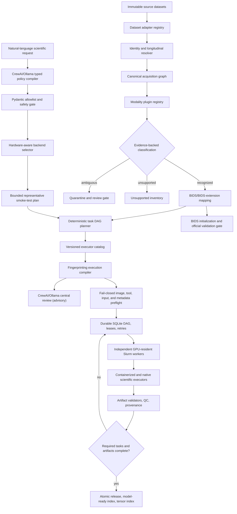

# NeuroPrep Agentic

Dataset-agnostic control plane for multimodal neurodata ingestion, BIDS-style
normalization, longitudinal consolidation, preprocessing planning, validation,
and completion accounting.

Dataset adapters normalize source metadata; modality plugins detect and plan
acquisitions. The same engine can therefore handle OASIS4, OASIS3, ADNI,
ANMERGE, A4, IDEAS, AIBL, MR-RATE, and future datasets without cohort branches.

## Architecture



CrewAI and Ollama are the reasoning layer. They do not guess modalities, edit
source data, or replace scientific software. Deterministic code creates identity
mappings, BIDS mappings, dependencies, resource requests, evidence, and
completion decisions. Agents review that evidence through policy gates.

Prompt instructions are supported, but deliberately constrained. A prompt can
select an objective, desired output families, and allowlisted package
preferences. The `prompt-run` command separately extracts the source and output
roots with deterministic code, accepts only the two approved cluster namespaces,
inventories the source, builds a manifest, compiles the full execution DAG, and
can initialize or submit it. The LLM cannot introduce commands, images, metadata
values, scheduler directives, or bypass BIDS/artifact/QC gates. Both the typed
policy and its digest are embedded in every compiled execution plan.

## Invariants

- Source files are immutable.
- Patient identifiers use a keyed deterministic pseudonym.
- Cross-dataset identities merge only through an explicit crosswalk.
- Longitudinal acquisitions are grouped by patient and ordered from baseline.
- Ambiguous acquisitions are quarantined; an LLM may not choose a modality.
- Missing optional modalities never make an otherwise valid patient incomplete.
- Core BIDS, extensions, and provisional mappings remain distinguishable.
- DTI derives from DWI; QSM derives from susceptibility acquisitions.
- Tasks declare dependencies and CPU/GPU/memory/time requirements.
- Completion uses a declared contract, not an agent narrative.

## Coverage

The initial registry covers structural MRI (T1w, T2w, FLAIR, PDw, UNIT1,
T2-star, SWI, quantitative MRI), BOLD fMRI, ASL, DWI/DTI, field maps, MRS, PET,
CT, SPECT, EEG, iEEG, MEG, fNIRS, microscopy, physiology, behavior, genetics,
and neurosonography. New modalities are plugins, not changes to core ingestion.

The runtime creates `dataset_description.json`, isolates provisional extensions
with `.bidsignore`, and runs BIDS Validator 3.0.1 before scientific processing.

Vendor spectroscopy inputs are converted to anonymized NIfTI-MRS with
spec2nii before FSL-MRS processing. SPECT NIfTI is validated and canonicalized
without changing quantitative intensities; ultrasound video is normalized
losslessly to FFV1 with explicit stream QC.

Behavior JSON/CSV is normalized to TSV, EDF physiology is converted to FIF with
recording QC, and optional EEG features contain computed spectral band powers.

Every registered task route has a concrete deterministic executor definition.
Scientific qualification remains evidence-based: a route is released for a
dataset only after its metadata, container/tool, artifacts, and QC contracts
pass on that dataset. Provisional modalities fail closed instead of being
presented as validated merely because they were detected.

## Commands

All paths must be under `/nfs-stor/salma.hassan` or `/l/users/salma.hassan`.

```bash
neuroprep-agentic hardware-profile \
  --output /nfs-stor/salma.hassan/run/hardware.json

# One prompt can bind X/Y, discover all supported inputs, consolidate patients
# and visits, compile the executable DAG, and preflight it. Initialization or
# submission requires signed evidence when the backend plan has smoke tests.
neuroprep-agentic prompt-run \
  --request 'My data is at /nfs-stor/salma.hassan/source; preprocess all modalities and longitudinal visits and save to /nfs-stor/salma.hassan/run' \
  --agentic-project /nfs-stor/salma.hassan/NeuroPrep-agentic \
  --freesurfer-license /nfs-stor/salma.hassan/licenses/freesurfer.txt

# Add --submit to launch central review, workers, and the final release gate.
# Omit --initialize/--submit for a read-only-source planning and preflight run.

neuroprep-agentic prompt-policy \
  --request-file /nfs-stor/salma.hassan/run/request.txt \
  --hardware-profile /nfs-stor/salma.hassan/run/hardware.json \
  --output /nfs-stor/salma.hassan/run/policy.json
neuroprep-agentic backend-plan \
  --policy /nfs-stor/salma.hassan/run/policy.json \
  --hardware-profile /nfs-stor/salma.hassan/run/hardware.json \
  --output /nfs-stor/salma.hassan/run/backend-plan.json

# Flat qualification evidence is retained for planning and compatibility only.
# Production initialization uses the signed workflow in docs/backend-evidence.md.
neuroprep-agentic qualification-evidence \
  /nfs-stor/salma.hassan/run/execution-plan.json \
  --output /nfs-stor/salma.hassan/run/backend-evidence.json

neuroprep-agentic coverage --output /nfs-stor/salma.hassan/results/coverage.json
neuroprep-agentic ingest-plan \
  /nfs-stor/salma.hassan/NeuroPrep-agentic/examples/synthetic_multimodal_manifest.json \
  --identity-key 'replace-with-a-secret-at-least-12-characters' \
  --output /nfs-stor/salma.hassan/results/plan.json
neuroprep-agentic schemas --output /nfs-stor/salma.hassan/results/schemas.json

neuroprep-agentic executor-coverage \
  --output /nfs-stor/salma.hassan/results/executor-coverage.json
neuroprep-agentic compile-run MANIFEST.json \
  --identity-key 'replace-with-a-secret-at-least-12-characters' \
  --source-root /nfs-stor/salma.hassan/source \
  --bids-root /nfs-stor/salma.hassan/run/bids \
  --derivatives-root /nfs-stor/salma.hassan/run/derivatives \
  --work-root /nfs-stor/salma.hassan/run/work \
  --state-path /nfs-stor/salma.hassan/run/state/tasks.sqlite \
  --agentic-project /nfs-stor/salma.hassan/NeuroPrep-agentic \
  --freesurfer-license /nfs-stor/salma.hassan/licenses/freesurfer.txt \
  --policy /nfs-stor/salma.hassan/run/policy.json \
  --hardware-profile /nfs-stor/salma.hassan/run/hardware.json \
  --output /nfs-stor/salma.hassan/run/execution-plan.json

scripts/install_cluster_tools.sh
neuroprep-agentic catalog-images --inspect
neuroprep-agentic prefetch-images /nfs-stor/salma.hassan/run/execution-plan.json --execute
neuroprep-agentic prepare-assets /nfs-stor/salma.hassan/run/execution-plan.json --execute
neuroprep-agentic preflight-run /nfs-stor/salma.hassan/run/execution-plan.json

# Submit central review, GPU workers, and the release gate.
scripts/launch_neuroprep_run.sh \
  /nfs-stor/salma.hassan/run/execution-plan.json 2
```

## GPU-resident CrewAI/Ollama

```bash
cd /nfs-stor/salma.hassan/NeuroPrep-agentic
sbatch scripts/slurm/neuroprep_agentic_gpu.sbatch

# Compile a prompt and backend/smoke plan entirely on a scheduled GPU.
sbatch --export=ALL,\
NEUROPREP_REQUEST_FILE=/nfs-stor/salma.hassan/run/request.txt,\
NEUROPREP_POLICY_OUTPUT=/nfs-stor/salma.hassan/run/policy.json \
  scripts/slurm/neuroprep_prompt_policy_gpu.sbatch

# Run the complete prompt compiler on a scheduled GPU. Set
# NEUROPREP_SUBMIT=true only when the compiled run should be launched. Set
# NEUROPREP_AGENTIC_PROJECT when executing an immutable production clone.
sbatch --export=ALL,\
NEUROPREP_REQUEST_FILE=/nfs-stor/salma.hassan/run/request.txt,\
NEUROPREP_AGENTIC_PROJECT=/nfs-stor/salma.hassan/NeuroPrep-agentic,\
NEUROPREP_FREESURFER_LICENSE=/nfs-stor/salma.hassan/licenses/freesurfer.txt,\
NEUROPREP_SUBMIT=false \
  scripts/slurm/neuroprep_prompt_run_gpu.sbatch
```

The backend portfolio records multiple packages per capability. Only pinned,
integrated executors are eligible for selection. Other packages remain explicit
qualification candidates until their adapters and representative smoke tests
pass; the agent may plan those tests but cannot silently promote a candidate.

Diffusion planning also inspects measured q-space sampling. Shelled data uses
GPU Eddy; DSI-like data with more than six nominal nonzero b-value levels uses
QSIPrep SHORELine (`--hmc-model 3dSHORE`) because FSL Eddy does not support DSI.
The selected model and b-value evidence are stored in the task metadata.

For an agent review of a manifest, export `NEUROPREP_WORKFLOW=ingest_plan`,
`NEUROPREP_MANIFEST_PATH`, and a strong `NEUROPREP_IDENTITY_KEY` before
submitting with `sbatch --export=ALL`.

The launcher starts loopback-only Ollama in Singularity on the allocated GPU.
It puts XDG state, temporary directories, models, package/container caches, and
CrewAI state on NFS; preflights `/usr/bin/singularity`; excludes `gpu-03`; binds
NFS directories to `/tmp` and `/var/tmp`; and disables Ollama cloud access.
`prepare-assets` also integrity-checks the offline Nextflow 24.10.3 jar and the
ASLPrep MNI6-to-MNI2009c transform so large assets never spill into the small
contained root filesystem.

Each compiled container command receives a task-specific NFS-backed container
home, `/tmp`, and `/var/tmp`; the host `HOME` environment is never reassigned.
Workers use transactional claims and renewable leases; failed attempts retry up
to the declared limit, terminal failures block descendants,
and completed artifacts are never silently reopened.

`finalize-run` is the only release gate. It verifies plan/state identity, zero
incomplete required tasks, and the continued existence of every recorded
artifact before atomically writing `release-summary.json`,
`model-ready-index.jsonl`, and `tensor-index.jsonl`.

See `docs/architecture.md`, `docs/modality-matrix.md`, and
`docs/dataset-onboarding.md`.
