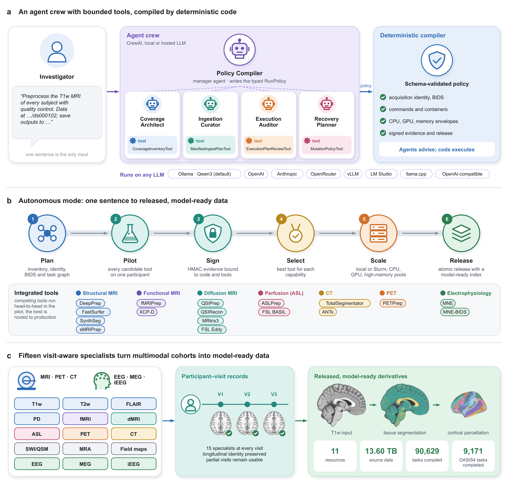
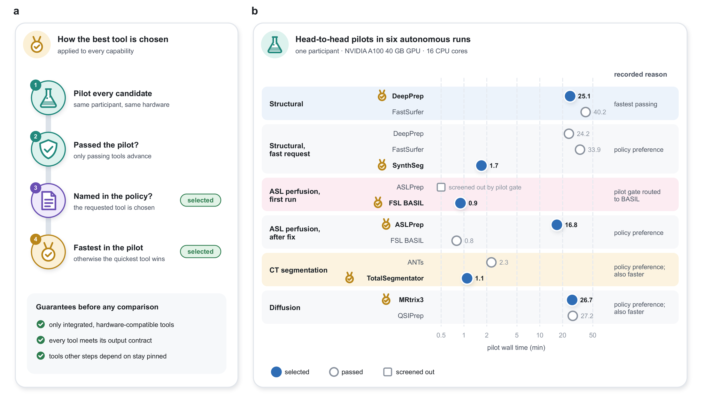
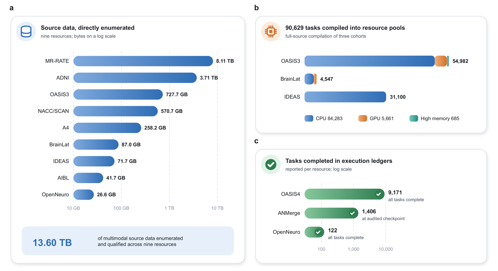

<p align="center">
  
</p>

<h1 align="center">NeuroPrep</h1>

<p align="center">
  <b>One sentence in. Released, model-ready neuroimaging data out.</b><br>
  An agentic study compiler that turns a plain-language request into a pilot-qualified,<br>
  fully provenanced run, from raw MRI, PET, CT, EEG/MEG and more to a model-ready dataset.
</p>

<p align="center">
  <a href="https://pypi.org/project/neuroprep-agentic/"></a>
  
  <a href="https://biomedia-mbzuai.github.io/NeuroPrep/"></a>
  
  
  
</p>

<p align="center">
  <a href="#quick-start">Quick start</a> ·
  <a href="#how-it-works">How it works</a> ·
  <a href="#the-best-tool-for-your-data-chosen-automatically">Tool selection</a> ·
  <a href="#proven-at-cohort-scale">At scale</a> ·
  <a href="#supported-modalities">Modalities</a> ·
  <a href="#chat-and-live-dashboard">Chat &amp; dashboard</a> ·
  <a href="https://biomedia-mbzuai.github.io/NeuroPrep/">Docs</a> ·
  <a href="#license-and-citation">Citation</a>
</p>

<p align="center">
  
</p>
<p align="center"><sub>Brain images are illustrative renderings of the MNI152 template and the fsaverage surface.</sub></p>

---

## Why NeuroPrep

Preprocessing a multimodal, longitudinal study usually means stitching together a dozen
tools by hand, guessing which one suits your data and hardware, and hoping a cluster run
survives the weekend. NeuroPrep compiles the whole study for you.

- 💬 **Say it in one sentence.** *"Preprocess every modality and visit and save to /data/run."*
  A language model compiles it into a typed, allowlisted policy: objectives and preferred
  packages, never commands, containers or paths.
- 🤖 **An agent crew with bounded tools.** A Policy Compiler manager agent plus Coverage
  Architect, Ingestion Curator, Execution Auditor and Recovery Planner agents, each acting
  through one narrow tool. **Agents advise; deterministic code executes.**
- 🧪 **Evidence before production.** A one-participant pilot runs every competing tool on
  *your* data and hardware, and an HMAC-signed evidence document binds the result to the
  exact git commit.
- 🏆 **The best tool, chosen for you.** Only tools that pass the pilot advance; a package
  you named wins, otherwise the fastest one is routed. Every decision is recorded with its reason.
- 🧠 **Fifteen visit-aware specialists.** Structural, functional, diffusion and perfusion
  MRI, PET, CT, susceptibility, angiography, field maps, EEG, MEG and iEEG, with
  longitudinal identity preserved and partial visits kept usable.
- ⚡ **Built for clusters.** A durable SQLite task graph with leases and retries; CPU, GPU
  and high-memory pools; Slurm workers; offline containers and fail-closed preflight.
- ✅ **"Done" means verified.** Completion is a declared contract: tasks, artifacts, QC and
  provenance are checked before an atomic release with a model-ready index.
- 🔌 **Any model provider.** Local Ollama by default; OpenAI, Anthropic, OpenRouter, vLLM,
  LM Studio, llama.cpp or any OpenAI-compatible server.

## Quick start

NeuroPrep needs Python 3.11, 3.12 or 3.13 on Linux or macOS.

```bash
python -m venv .venv && . .venv/bin/activate
python -m pip install neuroprep-agentic        # or: pip install git+https://github.com/BioMedIA-MBZUAI/NeuroPrep
neuroprep-agentic --version
neuroprep-agentic runtime-check                # model provider, containers and tools on this host
```

Then hand it a whole study in one sentence:

```bash
neuroprep-agentic auto "My data is at /data/neuroprep/source; preprocess every modality and visit and save to /data/neuroprep/run"
```

Use `--execute local` to run on this host, `--execute slurm` to submit workers, or
`--execute plan-only` to stop after the pilot with a ready production plan. Scientific
applications (FreeSurfer, fMRIPrep, QSIPrep and so on) run from containers that are
checked, and can be prefetched, before a run starts; see [Configuring a host](https://biomedia-mbzuai.github.io/NeuroPrep/configuration/).

## How it works

| | Stage | What happens |
|:-:|---|---|
| 1 | **Plan** | Inventory, keyed pseudonyms, visit assembly, BIDS mapping and a compiled task graph |
| 2 | **Pilot** | Every candidate tool runs on the same participant, on this hardware |
| 3 | **Sign** | Pilot results become HMAC-signed evidence bound to the code and tool versions |
| 4 | **Select** | One tool per capability, with the reason recorded |
| 5 | **Scale** | Production runs locally or on Slurm across CPU, GPU and high-memory pools |
| 6 | **Release** | Contracts are checked, then an atomic release writes the model-ready index |

The model is called once, to compile the request. Everything after that is deterministic
code: identity mapping, BIDS conversion, dependencies, resources, evidence and the release
decision. Production starts only after the pilot qualifies, and every stage is logged to
`autopilot-report.json`.

## The best tool for your data, chosen automatically

<p align="center">
  
</p>

When a capability has more than one integrated, hardware-compatible tool, the pilot runs
all of them on the same participant. These comparisons were validated for v0.5.0 on public
OpenNeuro subsets, on Slurm nodes with one NVIDIA A100-SXM4-40GB GPU, 16 CPU cores and
64 GB of memory, with Qwen3 14B served locally by Ollama:

| Capability | Tools compared | Pilot result (1 participant) | Selected |
|---|---|---|---|
| Whole-brain segmentation (T1w) | DeepPrep 25.1.0, FastSurfer 2.6.1 | 25.1 vs 40.2 min | DeepPrep (fastest) |
| ... when speed or low memory is requested | + SynthSeg (FreeSurfer 7.4.1) | SynthSeg 1.7 min | SynthSeg (request) |
| ASL perfusion | ASLPrep 26.0.3, FSL BASIL | 16.8 vs 0.8 min | ASLPrep (request) |
| CT segmentation | ANTs (NeuroPrep spatial), TotalSegmentator 2.18.0 | 2.3 vs 1.1 min | TotalSegmentator (request) |
| Diffusion preprocessing | MRtrix3 3.0.8, QSIPrep 26.0.0 (+ QSIRecon) | 26.7 vs 27.2 min | MRtrix3 (request) |

The pilot gate keeps runs moving: a tool that does not pass is screened out and the run
continues with the passing alternative (in an early ASL validation, FSL BASIL took over
from ASLPrep automatically). Pilots compare reliability and runtime on your data; they do
not rank segmentation or perfusion accuracy.

## Proven at cohort scale

<p align="center">
  
</p>

| 📦 13.60 TB | 🗂️ 11 resources | 🧩 90,629 tasks compiled | ✅ 9,171 / 9,171 OASIS4 tasks complete |
|:-:|:-:|:-:|:-:|
| source data enumerated | cohorts and archives | CPU, GPU and high-memory pools | plus 122 / 122 on OpenNeuro |

## Supported modalities

| Family | Inputs | Executor |
|---|---|---|
| 🧠 Structural MRI | T1w, T2w, FLAIR, PDw | sMRIPrep, DeepPrep / FastSurfer / SynthSeg, NeuroPrep spatial |
| 🔥 Functional MRI | BOLD task and rest | fMRIPrep + XCP-D |
| 🧵 Diffusion MRI | DWI, DTI, DKI, HARDI, DSI | QSIPrep + QSIRecon, or MRtrix3 |
| 🩸 Perfusion MRI | ASL | ASLPrep or FSL BASIL |
| 🧲 Susceptibility and quantitative MRI | SWI, QSM, UNIT1, T2*, qMRI maps | NeuroPrep v4, QSMxT routing |
| 🧪 Spectroscopy | SVS, MRSI, vendor raw | spec2nii + FSL-MRS |
| ☢️ PET, SPECT | static and dynamic PET, SPECT | PETPrep; quantitative-preserving validation |
| 🩻 CT | non-contrast, CTA, perfusion CT | NeuroPrep spatial (ANTs) or TotalSegmentator |
| ⚡ Electrophysiology | EEG, iEEG, MEG | NeuroPrep v4 MNE pipelines |
| 🔬 Optical and other | fNIRS, microscopy, ultrasound, physiology, behaviour, genetics | typed native normalization and QC |

The full routing table, with versions and BIDS targets, is in
the [modality matrix](https://biomedia-mbzuai.github.io/NeuroPrep/modality-matrix/). New modalities are plugins, not
changes to core ingestion.

## Chat and live dashboard

Prefer a browser? The local interface runs the same pipeline from a chat box, with a live
dashboard for every run.

```bash
neuroprep-agentic interface \
  --agentic-project /data/neuroprep/NeuroPrep-agentic \
  --port 8787
```

Open `http://127.0.0.1:8787/chat`, type your request (or attach a folder) and pick how to
run it: **here, to completion**, **pilot + plan only**, or **submit to Slurm**. Each run
links to a live dashboard with the stage tracker, a task timeline, the live log, GPU and
CPU load, and the pilot runtime of every compared tool with the one chosen.

<details>
<summary><b>More on the interface</b></summary>

The server binds only to loopback. When NeuroPrep runs on a cluster, create a tunnel from
the workstation and use the same URL:

```bash
ssh -N -L 8787:127.0.0.1:8787 USER@CLUSTER
```

The interface accepts only scientific request fields. Paths are validated by the
deterministic prompt-run boundary, and commands, containers, scheduler directives, task
state and release decisions are not part of its API. The planning page at `/` inventories
the source and writes planning artifacts but does not start workers, submit jobs or release
derivatives.

**Chat.** Name the input folder in the request, for example *"Preprocess the structural
T1-weighted MRI of every subject with quality control. My data is at /data/bids."*, or
attach the data with **Attach folder** / **Attach files** (uploaded to
`$NEUROPREP_OUTPUT_ROOT/uploads/`, keeping the folder layout; at most
`NEUROPREP_MAX_UPLOAD_MB`, default 20480, per file). Naming an output folder ("save outputs
to /data/out") is optional: otherwise results go to a new folder named after the input
under `NEUROPREP_OUTPUT_ROOT` (default `$NEUROPREP_HOME/runs`). When something is missing
or unusable (no input, a folder outside the allowed roots, an output folder that already
has files) the page asks for it, and the answer completes the original request.

- **here, to completion** (`--execute local`): run on the host serving the page, e.g.
  inside a GPU job; the released files are listed in the chat when done.
- **pilot + plan only** (`--execute plan-only`): qualify the tools on a pilot and stop at
  the production plan.
- **submit to Slurm** (`--execute slurm`): submit the production workers.

**Dashboard** (`/dashboard?run=<id>`): the stage tracker, task counts, a timeline of every
task (tool × subject, pilot and production, coloured by status and growing while it runs),
the live log of the running task (or any task you click), GPU utilisation and memory, CPU
load and RAM sampled every 5 s on the serving node, and the pilot runtime of each compared
tool. It reads the run's own task database read-only and refreshes every 3 s.

Each request starts one `auto` process; the page shows its stages as they finish, the
tools chosen, the log tail and, at the end, the released files from
`derivatives/release/model-ready-index.jsonl`. The process log is written next to the
output folder (`<output>.chat-run.log`). Runs are tracked while the server is up; after a
restart the reports and outputs remain on disk. The chat page executes the run, so start
the server only where that is allowed (on a cluster: inside a compute job, never on the
login node).

</details>

## Documentation

The full documentation is at **[biomedia-mbzuai.github.io/NeuroPrep](https://biomedia-mbzuai.github.io/NeuroPrep/)**.

| Topic | Page |
|---|---|
| Install, check a host, development setup | [Installation](https://biomedia-mbzuai.github.io/NeuroPrep/installation/) |
| From raw files to released derivatives in one command | [Quick start](https://biomedia-mbzuai.github.io/NeuroPrep/quickstart/) |
| Autopilot stages, comparing backends, derivative interfaces, guarantees | [How it works](https://biomedia-mbzuai.github.io/NeuroPrep/how-it-works/) |
| Validated comparisons and what each backend must produce | [Backend comparisons](https://biomedia-mbzuai.github.io/NeuroPrep/backends/) |
| Ollama, OpenAI, Anthropic, OpenRouter, vLLM and other providers | [Language models](https://biomedia-mbzuai.github.io/NeuroPrep/llm-providers/) |
| `NEUROPREP_*` variables, allowed roots, tools and images | [Configuring a host](https://biomedia-mbzuai.github.io/NeuroPrep/configuration/) |
| Slurm launchers, GPU-resident model, step-by-step workflow | [Running on Slurm](https://biomedia-mbzuai.github.io/NeuroPrep/slurm/) |
| Every command and option | [Command line](https://biomedia-mbzuai.github.io/NeuroPrep/cli/) |
| Component architecture, signed evidence, modality matrix, dataset onboarding | [Concepts](https://biomedia-mbzuai.github.io/NeuroPrep/architecture/) |

## License and citation

NeuroPrep is released under the PolyForm Noncommercial License 1.0.0 (see the
`LICENSE` file, also included in every installed copy).
Research, teaching, personal study and use by academic, non-profit, public
health and government institutions are permitted. Commercial use requires a
separate written license from the copyright holder.

If NeuroPrep contributes to a publication, presentation or other output, please
cite it using `CITATION.cff` (GitHub shows this as "Cite this repository"). Redistributions must keep the `Required Notice:` lines
at the top of `LICENSE`.

The package bundles the NeuroPrep multimodal v4 code (`neuroprep_agentic/vendor/neuroprep_v4`)
under its own Apache License 2.0, included in that folder; it is unchanged from its source.
