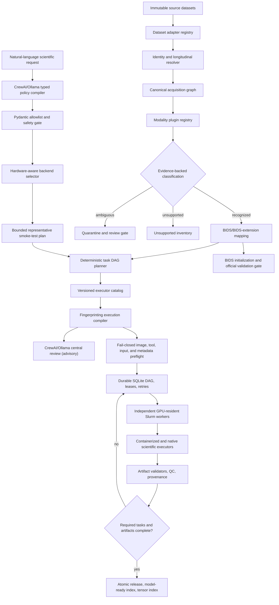

# NeuroPrep Agentic

Dataset-agnostic control plane for multimodal neurodata ingestion, BIDS-style
normalization, longitudinal consolidation, preprocessing planning, validation,
and completion accounting.

## Installation

NeuroPrep requires Python 3.11 or 3.12 on Linux or macOS. Install it in an
isolated environment, then verify the runtime services and scientific assets
available on the execution host:

```bash
python -m venv .venv
. .venv/bin/activate
python -m pip install neuroprep-agentic
neuroprep-agentic --version
neuroprep-agentic runtime-check
```

The Python package installs the compiler, agentic control plane, native
executors and command-line interface. External scientific applications and
container images remain explicit deployment assets and are checked before a
run is initialized.

### Fully autonomous runs

Give NeuroPrep one request that names the input and output paths; it handles the rest:

```bash
neuroprep-agentic auto "My data is at /data/neuroprep/source; preprocess every modality and visit and save to /data/neuroprep/run"
```

The autopilot calls the model once to compile the request into a typed policy, then
runs every remaining stage deterministically: inventory and plan compilation; choice
of the smallest set of participants that exercises every required backend; a
complete pilot run of those participants on this host; an audited, HMAC-signed
evidence document binding the pilot to the target plan; and the production run
(`--execute local` on this host, `--execute slurm` to submit workers, or
`--execute plan-only`) followed by release. A failed pilot stops the run before any
production task starts. Every stage is written to `autopilot-report.json` (with
`approval: autonomous`) next to the run and in `<run>.neuroprep-qualification/`.

Evidence binds the git commit of `NEUROPREP_AGENTIC_PROJECT`, so the checkout must be
clean. Without `--signing-key` a run-local `0600` key is created under the
qualification root. Today each capability has one integrated backend, so the pilot
qualifies that backend on your data and hardware; adding executor adapters for
alternative packages makes the same loop choose among them.

### Choosing a language model

The policy compiler and the advisory review crew work with any of these
providers. Name models as `provider/model`; no extra SDK is needed.

| Provider | Example `NEUROPREP_MANAGER_MODEL` | Required environment |
|---|---|---|
| Ollama (default) | `ollama/qwen3:14b` | `OLLAMA_BASE_URL` (default `http://127.0.0.1:11434`) |
| OpenAI | `openai/gpt-4o-mini` | `OPENAI_API_KEY` |
| Anthropic (Claude) | `anthropic/claude-sonnet-5-5` | `ANTHROPIC_API_KEY` |
| OpenRouter | `openrouter/anthropic/claude-sonnet-5.5` | `OPENROUTER_API_KEY` |
| vLLM | `vllm/Qwen/Qwen3-8B` | `NEUROPREP_LLM_BASE_URL` (default `http://127.0.0.1:8000/v1`) |
| LM Studio | `lmstudio/<loaded model>` | `NEUROPREP_LLM_BASE_URL` (default `http://127.0.0.1:1234/v1`) |
| llama.cpp server | `llamacpp/<model>` | `NEUROPREP_LLM_BASE_URL` (default `http://127.0.0.1:8080/v1`) |
| Any OpenAI-compatible server | `openai_compatible/<model>` | `NEUROPREP_LLM_BASE_URL`, optional `NEUROPREP_LLM_API_KEY` |

```bash
export NEUROPREP_MANAGER_MODEL=anthropic/claude-sonnet-5-5
export NEUROPREP_WORKER_MODEL=anthropic/claude-haiku-5-5
export ANTHROPIC_API_KEY=...
neuroprep-agentic runtime-check   # reports the provider and whether it is reachable
```

`NEUROPREP_WORKER_MODEL` drives the advisory review agents. The older
`OLLAMA_MANAGER_MODEL`/`OLLAMA_WORKER_MODEL` variables still work. Hosted
providers never receive `NEUROPREP_LLM_BASE_URL`; use `OPENAI_BASE_URL`,
`OPENROUTER_BASE_URL` or `ANTHROPIC_BASE_URL` to route them through a proxy.

Structured output uses each provider's native mechanism: Ollama's schema
`format`, OpenAI-style `json_schema` (degrading to JSON mode, then a prompt,
on servers that reject it), and forced tool use for Claude. Every reply is
then validated against the `RunPolicy` schema, so a weaker model can fail
validation but cannot widen what NeuroPrep executes. Exact plan
reproducibility needs a pinned local model with a fixed seed; hosted APIs do
not guarantee deterministic output.

### Configuring a host

NeuroPrep has no built-in site paths. Every host-specific location comes from
the environment, with defaults under `NEUROPREP_HOME` (`~/.neuroprep`):

| Variable | Purpose | Default |
|---|---|---|
| `NEUROPREP_HOME` | Run state, logs and default asset locations | `~/.neuroprep` |
| `NEUROPREP_ALLOWED_ROOTS` | Extra data roots plans may read and write (`:`-separated); home and `NEUROPREP_HOME` are always allowed | none |
| `NEUROPREP_TOOLS_ROOT` | Native tools (FSL-MRS, dcm2niix, Nextflow, TemplateFlow seeds) | `$NEUROPREP_HOME/tools` |
| `NEUROPREP_CONTAINER_ROOT` | Singularity/Apptainer images | `$NEUROPREP_HOME/containers` |
| `NEUROPREP_V4_PROJECT` | NeuroPrep multimodal v4 checkout used by v4 executors | `$NEUROPREP_HOME/NeuroPrep-multimodal-v4` |
| `NEUROPREP_AGENTIC_PROJECT` | Git checkout whose commit is recorded in compiled plans | this checkout, else `$NEUROPREP_HOME/NeuroPrep-agentic` |
| `NEUROPREP_FSL_MRS_ROOT`, `NEUROPREP_DCM2NIIX`, `NEUROPREP_ANTS_IMAGE` | Individual tool overrides | under the tools/container roots |

Compiled execution plans record the git commit of `NEUROPREP_AGENTIC_PROJECT`
as provenance, so plan compilation and evidence binding need a git checkout of
this repository (a pip install alone is enough for planning, policy
compilation, the browser interface and the native executors). Bundled helper
files such as the Eddy wrapper always come from the installed package.

CrewAI usage telemetry and OpenTelemetry export are disabled by default; set
`CREWAI_TELEMETRY_OPT_OUT=false` to opt in.

Dataset adapters normalize source metadata; modality plugins detect and plan
acquisitions. The same engine can therefore handle OASIS4, OASIS3, ADNI,
ANMERGE, A4, IDEAS, AIBL, MR-RATE, and future datasets without cohort branches.

## Architecture



CrewAI and Ollama are the general instruction and planning layer. OpenJev is an
optional local typed-decision layer for high-volume routing and bounded recovery
decisions. Neither reasoning layer guesses modalities, edits source data, or
replaces scientific software. Deterministic code creates identity mappings,
BIDS mappings, dependencies, resource requests, evidence, and completion
decisions. OpenJev reviews only unresolved acquisitions when
`prompt-run --openjev-review` is enabled; its output is advisory and is recorded
in `openjev-review.json`.

Prompt instructions are supported, but deliberately constrained. A prompt can
select an objective, desired output families, and allowlisted package
preferences. The `prompt-run` command separately extracts the source and output
roots with deterministic code, accepts only the configured data roots,
inventories the source, builds a manifest, compiles the full execution DAG, and
can initialize or submit it. The LLM cannot introduce commands, images, metadata
values, scheduler directives, or bypass BIDS/artifact/QC gates. Both the typed
policy and its digest are embedded in every compiled execution plan.

## Invariants

- Source files are immutable.
- Patient identifiers use a keyed deterministic pseudonym.
- Cross-dataset identities merge only through an explicit crosswalk.
- Longitudinal acquisitions are grouped by patient and ordered from baseline.
- Ambiguous acquisitions are quarantined; an LLM may not choose a modality.
- Missing optional modalities never make an otherwise valid patient incomplete.
- Core BIDS, extensions, and provisional mappings remain distinguishable.
- DTI derives from DWI; QSM derives from susceptibility acquisitions.
- Tasks declare dependencies and CPU/GPU/memory/time requirements.
- Completion uses a declared contract, not an agent narrative.

## Coverage

The initial registry covers structural MRI (T1w, T2w, FLAIR, PDw, UNIT1,
T2-star, SWI, quantitative MRI), BOLD fMRI, ASL, DWI/DTI, field maps, MRS, PET,
CT, SPECT, EEG, iEEG, MEG, fNIRS, microscopy, physiology, behavior, genetics,
and neurosonography. New modalities are plugins, not changes to core ingestion.

The runtime creates `dataset_description.json`, isolates provisional extensions
with `.bidsignore`, and runs BIDS Validator 3.0.1 before scientific processing.

Vendor spectroscopy inputs are converted to anonymized NIfTI-MRS with
spec2nii before FSL-MRS processing. SPECT NIfTI is validated and canonicalized
without changing quantitative intensities; ultrasound video is normalized
losslessly to FFV1 with explicit stream QC.

Behavior JSON/CSV is normalized to TSV, EDF physiology is converted to FIF with
recording QC, and optional EEG features contain computed spectral band powers.

Every registered task route has a concrete deterministic executor definition.
Scientific qualification remains evidence-based: a route is released for a
dataset only after its metadata, container/tool, artifacts, and QC contracts
pass on that dataset. Provisional modalities fail closed instead of being
presented as validated merely because they were detected.

## Browser interface

The local interface turns a natural-language study request into the same typed
policy, acquisition graph, backend plan and preflight report used by the CLI.
It inventories the source and writes planning artifacts, but deliberately does
not initialize workers, submit jobs or release derivatives.

```bash
neuroprep-agentic interface \
  --agentic-project /data/neuroprep/NeuroPrep-agentic \
  --port 8787
```

Open `http://127.0.0.1:8787`. The server binds only to loopback. When NeuroPrep
runs on a cluster, create a tunnel from the workstation and use the same URL:

```bash
ssh -N -L 8787:127.0.0.1:8787 USER@CLUSTER
```

The interface accepts only scientific request fields. Paths are validated by
the deterministic prompt-run boundary, and commands, containers, scheduler
directives, task state and release decisions are not part of its API.

## Commands

All paths must be under the executing user's home directory, `NEUROPREP_HOME`
or a root listed in `NEUROPREP_ALLOWED_ROOTS`. The examples below use
`/data/neuroprep`, allowed with `export NEUROPREP_ALLOWED_ROOTS=/data/neuroprep`.

```bash
neuroprep-agentic hardware-profile \
  --output /data/neuroprep/run/hardware.json

# One prompt can bind X/Y, discover all supported inputs, consolidate patients
# and visits, compile the executable DAG, and preflight it. Initialization or
# submission requires signed evidence when the backend plan has smoke tests.
neuroprep-agentic prompt-run \
  --request 'My data is at /data/neuroprep/source; preprocess all modalities and longitudinal visits and save to /data/neuroprep/run' \
  --agentic-project /data/neuroprep/NeuroPrep-agentic \
  --freesurfer-license /data/neuroprep/licenses/freesurfer.txt

# Add --submit to launch central review, workers, and the final release gate.
# Omit --initialize/--submit for a read-only-source planning and preflight run.

neuroprep-agentic prompt-policy \
  --request-file /data/neuroprep/run/request.txt \
  --hardware-profile /data/neuroprep/run/hardware.json \
  --output /data/neuroprep/run/policy.json
neuroprep-agentic backend-plan \
  --policy /data/neuroprep/run/policy.json \
  --hardware-profile /data/neuroprep/run/hardware.json \
  --output /data/neuroprep/run/backend-plan.json

# Flat qualification evidence is retained for planning and compatibility only.
# Production initialization uses the signed workflow in docs/backend-evidence.md.
neuroprep-agentic qualification-evidence \
  /data/neuroprep/run/execution-plan.json \
  --output /data/neuroprep/run/backend-evidence.json

neuroprep-agentic coverage --output /data/neuroprep/results/coverage.json
neuroprep-agentic ingest-plan \
  /data/neuroprep/NeuroPrep-agentic/examples/synthetic_multimodal_manifest.json \
  --identity-key 'replace-with-a-secret-at-least-12-characters' \
  --output /data/neuroprep/results/plan.json
neuroprep-agentic schemas --output /data/neuroprep/results/schemas.json

neuroprep-agentic executor-coverage \
  --output /data/neuroprep/results/executor-coverage.json
neuroprep-agentic compile-run MANIFEST.json \
  --identity-key 'replace-with-a-secret-at-least-12-characters' \
  --source-root /data/neuroprep/source \
  --bids-root /data/neuroprep/run/bids \
  --derivatives-root /data/neuroprep/run/derivatives \
  --work-root /data/neuroprep/run/work \
  --state-path /data/neuroprep/run/state/tasks.sqlite \
  --agentic-project /data/neuroprep/NeuroPrep-agentic \
  --freesurfer-license /data/neuroprep/licenses/freesurfer.txt \
  --policy /data/neuroprep/run/policy.json \
  --hardware-profile /data/neuroprep/run/hardware.json \
  --output /data/neuroprep/run/execution-plan.json

scripts/install_cluster_tools.sh
neuroprep-agentic catalog-images --inspect
neuroprep-agentic prefetch-images /data/neuroprep/run/execution-plan.json --execute
neuroprep-agentic prepare-assets /data/neuroprep/run/execution-plan.json --execute
neuroprep-agentic preflight-run /data/neuroprep/run/execution-plan.json

# Submit central review, GPU workers, and the release gate.
scripts/launch_neuroprep_run.sh \
  /data/neuroprep/run/execution-plan.json 2
```

## GPU-resident CrewAI/Ollama on Slurm

The source repository includes example Slurm launchers (`scripts/slurm/`) for a
cluster with Singularity and A100 GPUs. Site locations are set in one file,
`scripts/ciai_env.sh`; copy and edit it for another cluster.

```bash
cd /data/neuroprep/NeuroPrep-agentic
sbatch scripts/slurm/neuroprep_agentic_gpu.sbatch

# Compile a prompt and backend/smoke plan entirely on a scheduled GPU.
sbatch --export=ALL,\
NEUROPREP_REQUEST_FILE=/data/neuroprep/run/request.txt,\
NEUROPREP_POLICY_OUTPUT=/data/neuroprep/run/policy.json \
  scripts/slurm/neuroprep_prompt_policy_gpu.sbatch

# Run the complete prompt compiler on a scheduled GPU. Set
# NEUROPREP_SUBMIT=true only when the compiled run should be launched. Set
# NEUROPREP_AGENTIC_PROJECT when executing an immutable production clone.
sbatch --export=ALL,\
NEUROPREP_REQUEST_FILE=/data/neuroprep/run/request.txt,\
NEUROPREP_AGENTIC_PROJECT=/data/neuroprep/NeuroPrep-agentic,\
NEUROPREP_FREESURFER_LICENSE=/data/neuroprep/licenses/freesurfer.txt,\
NEUROPREP_SUBMIT=false \
  scripts/slurm/neuroprep_prompt_run_gpu.sbatch
```

The backend portfolio records multiple packages per capability. Only pinned,
integrated executors are eligible for selection. Other packages remain explicit
qualification candidates until their adapters and representative smoke tests
pass; the agent may plan those tests but cannot silently promote a candidate.

Diffusion planning also inspects measured q-space sampling. Shelled data uses
GPU Eddy; DSI-like data with more than six nominal nonzero b-value levels uses
QSIPrep SHORELine (`--hmc-model 3dSHORE`) because FSL Eddy does not support DSI.
The selected model and b-value evidence are stored in the task metadata.

For an agent review of a manifest, export `NEUROPREP_WORKFLOW=ingest_plan`,
`NEUROPREP_MANIFEST_PATH`, and a strong `NEUROPREP_IDENTITY_KEY` before
submitting with `sbatch --export=ALL`.

The launcher starts loopback-only Ollama in Singularity on the allocated GPU.
It puts XDG state, temporary directories, models, package/container caches, and
CrewAI state on shared storage; preflights `/usr/bin/singularity`; binds
NFS directories to `/tmp` and `/var/tmp`; and disables Ollama cloud access.
`prepare-assets` also integrity-checks the offline Nextflow 24.10.3 jar and the
ASLPrep MNI6-to-MNI2009c transform so large assets never spill into the small
contained root filesystem.

Each compiled container command receives a task-specific NFS-backed container
home, `/tmp`, and `/var/tmp`; the host `HOME` environment is never reassigned.
Workers use transactional claims and renewable leases; failed attempts retry up
to the declared limit, terminal failures block descendants,
and completed artifacts are never silently reopened.

`finalize-run` is the only release gate. It verifies plan/state identity, zero
incomplete required tasks, and the continued existence of every recorded
artifact before atomically writing `release-summary.json`,
`model-ready-index.jsonl`, and `tensor-index.jsonl`.

See `docs/architecture.md`, `docs/modality-matrix.md`, and
`docs/dataset-onboarding.md`.

## License and citation

NeuroPrep is released under the PolyForm Noncommercial License 1.0.0 (see the
`LICENSE` file, also included in every installed copy).
Research, teaching, personal study and use by academic, non-profit, public
health and government institutions are permitted. Commercial use requires a
separate written license from the copyright holder.

If NeuroPrep contributes to a publication, presentation or other output, please
cite it using `CITATION.cff` (GitHub shows this as "Cite this repository"). Redistributions must keep the `Required Notice:` lines
at the top of `LICENSE`.
