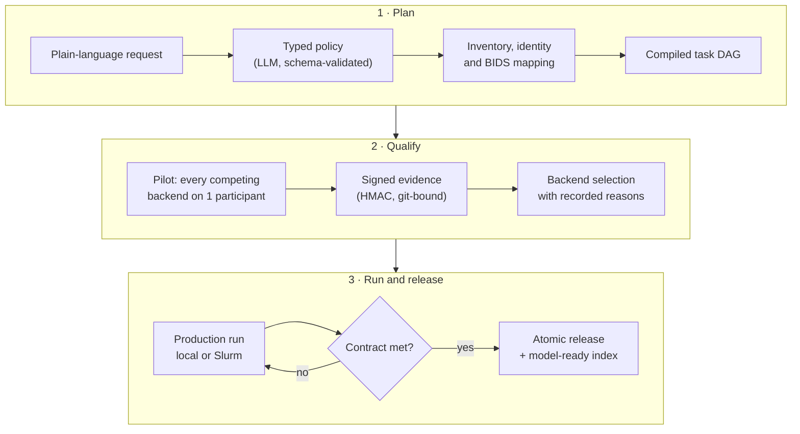

# How it works

The model is called once, to compile the request. Everything after that is
deterministic code: identity mapping, BIDS conversion, dependencies, resources,
evidence and the release decision. A failed pilot stops the run before any production
task starts, and every stage is logged to `autopilot-report.json`.

## Autonomous mode in detail

`neuroprep-agentic auto` calls the model once to compile the request into a typed
policy, then runs every remaining stage deterministically:

1. inventory and plan compilation;
2. choice of the smallest set of participants that exercises every required backend;
3. a complete pilot run of those participants on this host;
4. an audited, HMAC-signed evidence document binding the pilot to the target plan;
5. the production run (`--execute local` on this host, `--execute slurm` to submit
   workers, or `--execute plan-only`) followed by release.

Every stage is written to `autopilot-report.json` (with `approval: autonomous`) next to
the run and in `<run>.neuroprep-qualification/`.

Evidence binds the git commit of `NEUROPREP_AGENTIC_PROJECT`, so the checkout must be
clean. Without `--signing-key` a run-local `0600` key is created under the
qualification root.

## Comparing alternatives

When a capability has more than one integrated, hardware-compatible backend, the pilot
runs all of them on the same subjects, as optional tasks, so a backend that fails simply
loses. The signed evidence records each backend's pass/fail and measured runtime, and
production is routed to one backend per capability:

1. failed backends are rejected;
2. then a package named in the prompt wins;
3. then the shortest measured pilot runtime.

A capability whose backend another planned executor depends on (for example PETPrep on
DeepPrep's reconstruction) is pinned to it. `autopilot-report.json` lists the compared
backends, the losers and the reasons for each selection.

A backend only competes when it produces everything its capability promises
(`CAPABILITY_CONTRACTS` in `policy.py`), so a comparison never trades outputs for speed.
The validated comparisons are listed in [Backend comparisons](backends.md).

## Derivative interfaces

Downstream apps read **derivative interfaces** rather than a fixed producer: XCP-D
consumes `fmriprep_bold`, QSIRecon consumes `qsiprep_dwi`, and the compiler fills the
path from whichever planned backend provides it. An alternative that does not provide
an interface a planned consumer reads is rejected, unless it takes over that consumer's
mandatory stages (MRtrix3 fits tensors instead of QSIRecon; QSIRecon's optional advanced
models are then dropped with a plan warning). DeepPrep 25.1.0's BOLD output is not an
alternative yet: XCP-D 26.1.1 needs an MNI-space brain mask and ANTs transforms that
DeepPrep does not write.

## What the language model can and cannot do

A prompt can select an objective, desired output families and allowlisted package
preferences. Source and output roots are extracted by deterministic code and checked
against the configured data roots. The model cannot introduce commands, images,
metadata values or scheduler directives, or bypass the BIDS, artifact and QC gates.
Both the typed policy and its digest are embedded in every compiled execution plan.

Every model reply is validated against the `RunPolicy` schema, so a weaker model can
fail validation but cannot widen what NeuroPrep executes.

## Guarantees

- Source files are immutable.
- Patient identifiers use a keyed deterministic pseudonym.
- Cross-dataset identities merge only through an explicit crosswalk.
- Longitudinal acquisitions are grouped by patient and ordered from baseline.
- Ambiguous acquisitions are quarantined; an LLM may not choose a modality.
- Missing optional modalities never make an otherwise valid patient incomplete.
- Core BIDS, extensions, and provisional mappings remain distinguishable.
- DTI derives from DWI; QSM derives from susceptibility acquisitions.
- Tasks declare dependencies and CPU/GPU/memory/time requirements.
- Completion uses a declared contract, not an agent narrative.

## Release

`finalize-run` is the only release gate. It verifies plan/state identity, zero
incomplete required tasks, and the continued existence of every recorded artifact
before atomically writing `release-summary.json`, `model-ready-index.jsonl` and
`tensor-index.jsonl`.

For the full component view, see [Architecture](architecture.md).
