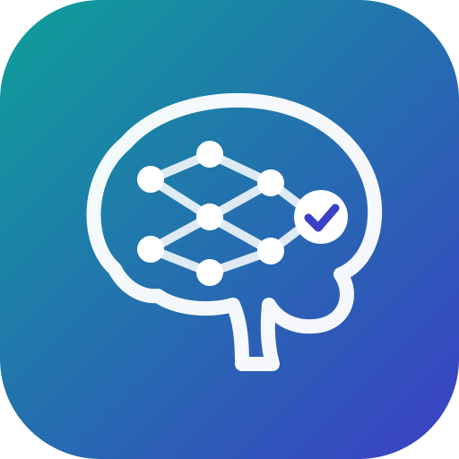

---
hide:
  - navigation
  - toc
---

<div class="np-hero" markdown>

{ .np-hero-logo }

# NeuroPrep

**One request in, validated multimodal neuroimaging derivatives out.**

An agentic study compiler that turns a plain-language request into a pilot-qualified,
fully provenanced preprocessing run, from raw MRI, PET, CT, EEG/MEG and more to a
released, model-ready dataset.

[Get started](quickstart.md){ .md-button .md-button--primary }
[How it works](how-it-works.md){ .md-button }

</div>

```bash
pip install neuroprep-agentic
neuroprep-agentic auto "My data is at /data/study; preprocess every modality and visit and save to /data/run"
```

<div class="grid cards" markdown>

-   :material-message-text-outline: **Plain-language requests**

    ---

    A language model compiles your request into a typed, allowlisted policy. It can
    choose objectives and preferred packages, never commands, containers or paths.

-   :material-flask-outline: **Evidence before production**

    ---

    A one-participant pilot runs every competing backend on your own data and hardware.
    Results are signed (HMAC) and bound to the exact git commit.

    [:octicons-arrow-right-24: Signed backend evidence](backend-evidence.md)

-   :material-scale-balance: **Automatic backend choice**

    ---

    Failed backends are rejected, then a package you named wins, otherwise the fastest
    qualified backend. Every decision is recorded with its reasons.

    [:octicons-arrow-right-24: Backend comparisons](backends.md)

-   :material-brain: **One engine, many modalities**

    ---

    Structural, functional, diffusion and perfusion MRI, PET, CT, SPECT, EEG, iEEG,
    MEG, fNIRS, spectroscopy, microscopy and more, without per-cohort code.

    [:octicons-arrow-right-24: Supported modalities](modalities.md)

-   :material-server-network: **Built for clusters**

    ---

    A durable SQLite task DAG with leases and retries, GPU and CPU lanes, Slurm
    workers, offline containers and fail-closed preflight.

    [:octicons-arrow-right-24: Running on Slurm](slurm.md)

-   :material-robot-outline: **Any model provider**

    ---

    Local Ollama by default; OpenAI, Anthropic, OpenRouter, vLLM, LM Studio,
    llama.cpp or any OpenAI-compatible server.

    [:octicons-arrow-right-24: Language models](llm-providers.md)

</div>

## Nothing is "done" on an agent's say-so

The model is called once, to compile the request. Everything after that is
deterministic code: identity mapping, BIDS conversion, dependencies, resources,
evidence and the release decision. Completion is a declared contract (required tasks,
artifacts, QC and provenance) checked before an atomic release.

## Citing NeuroPrep

If NeuroPrep contributes to your work, please cite it; see
[License and citation](citation.md).
